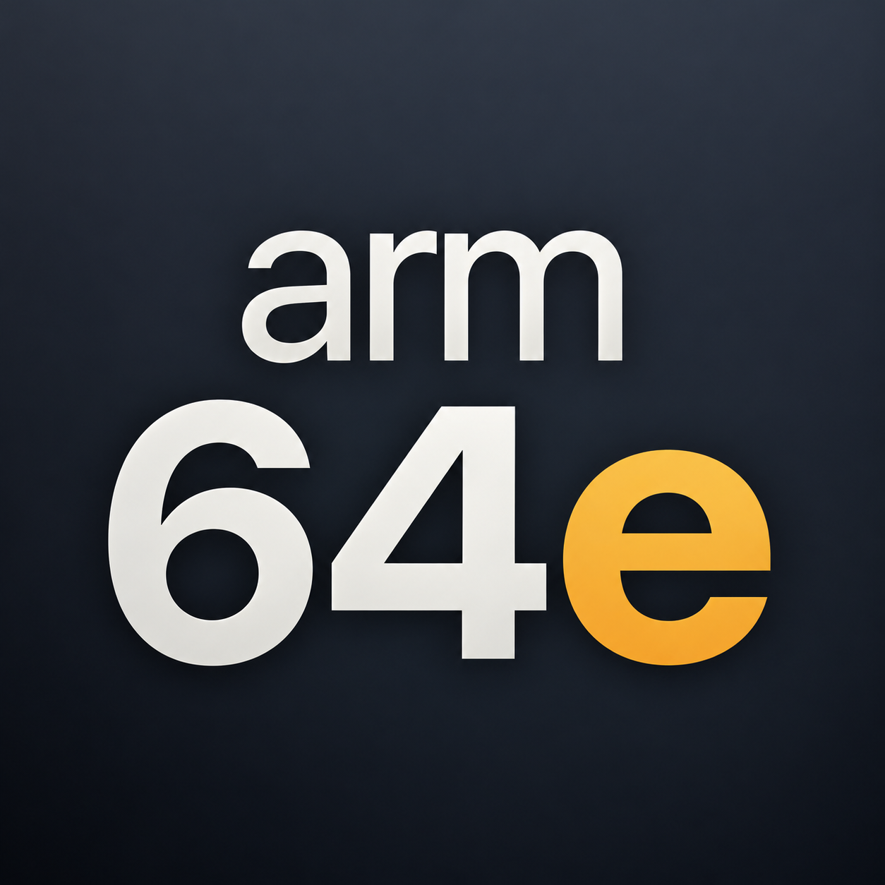

# Umbra Patcher

[English](#english) | [简体中文](#简体中文)

## English

Umbra Patcher converts supported tweak packages for RootHide custom firmware. It is an OwnGoal Studio fork of [RootHide Patcher](https://github.com/roothide/RootHidePatcher), with a redesigned interface and the original conversion engine. Requires iOS 15 or later and a working RootHide environment. Not every package is compatible.

### Conversion

Choose a method in the bottom drawer, then select a `.deb` or open one from another app. Conversion starts using the selected method, which is retained between packages.

| Method | Script argument | Behavior |
|---|---|---|
| Direct Conversion | Empty | Convert simple tweaks, including eligible rootful packages. |
| Rootless Compatibility (default) | `AutoPatches` | Apply the Rootless Compat Layer integration. |
| Dynamic Patches | `DynamicPatches` | Require the matching dynamic patch package. |

Successful packages can be shared (including Save to Files) or opened in a supported package manager. Irisin takes precedence over Sileo when installed; Zebra is also offered when available. Failed conversions retain the selected file and method for retry. Conversion logs can be selected, copied, and shared.

### Identity and upgrade

- Product: **Umbra Patcher 3.0**. Existing short labels remain **Patcher**, including the Home Screen name and About Patcher title.
- Bundle ID and Debian package ID: `wiki.qaq.umbra.patcher`.
- Installation: `/Applications/Patcher.app`.
- The package declares `Conflicts` and `Replaces` for `com.roothide.patcher`, following Umbra's migration from RootHide Manager.
- Existing files remain under `/var/mobile/RootHidePatcher` inside the RootHide environment. This compatibility path, the conversion script, process runner, RootHide library, entitlements, and runtime dependencies retain the upstream behavior.

The Git repository remains [owngoal-dev/RootHidePatcher](https://github.com/owngoal-dev/RootHidePatcher). Application branding and build targets use Umbra Patcher; upstream references and compatibility paths intentionally retain the original names.

### Build and check

Requires Xcode and, for Debian packages, Theos with the roothide scheme and `ldid`.

```sh
# Unsigned device build
xcodebuild -project UmbraPatcher.xcodeproj -scheme UmbraPatcher \
  -configuration Release -destination 'generic/platform=iOS' \
  -derivedDataPath /private/tmp/umbra-patcher-device CODE_SIGNING_ALLOWED=NO build

# Debug roothide package
make package DEBUG=1 FINALPACKAGE=0

# Regression tests; choose an available simulator
xcodebuild -project UmbraPatcher.xcodeproj -scheme UmbraPatcher \
  -destination 'platform=iOS Simulator,name=iPhone 16 Pro' \
  -derivedDataPath /private/tmp/umbra-patcher-tests CODE_SIGNING_ALLOWED=NO test

# Regenerate asset sizes from the approved icon artwork
sh Tools/prepare-icons.sh
```

`build.command` produces an ad hoc signed IPA using the renamed project. The simulator supports interface preview and file import only. Tests cover conversion arguments, output names, import preservation and replacement, failed imports, and rejection of real conversion in the simulator. Actual conversion and package-manager handoff require a RootHide device.

The app icon and in-app mark share the approved `arm64e` artwork in `Branding/UmbraPatcher.png`. Its generation prompt and provenance are recorded in `Branding/AppIcon.prompt.txt`.

### Credits and license

`roothideDev` is credited first for RootHide Patcher and its conversion engine, followed by haxi0, evelyneee, NightwindDev, and korboybeats. Umbra Patcher retains the [GNU GPL v3 license](LICENSE); [AuxiliaryExecute](AuxiliaryExecute/LICENSE) remains MIT licensed. Both notices are bundled and available in About → Licenses.

## 简体中文

Umbra Patcher 是 OwnGoal Studio 基于 RootHide Patcher 派生的安装包转换工具，保留原有转换引擎，提供重新设计的界面。需要 iOS 15 或更新版本及可用的 RootHide 自定义固件环境，并非所有安装包均兼容。

在底部抽屉选择转换方式，再选择 `.deb` 或从其他 App 打开安装包，即可按当前方式开始转换。支持直接转换、Rootless 兼容层和动态补丁三种方式。转换成功后可分享或交给包管理器；已安装 Irisin 时优先使用 Irisin，否则回退至 Sileo。Zebra 已安装时也会提供入口。“存储到文件”位于系统分享菜单中。

3.0 版本将 **RootHide Patcher** 品牌更名为 **Umbra Patcher**；原有 **Patcher** 简称（包括桌面名称和“关于 Patcher”标题）保持不变。Bundle ID 与 Debian 包名均为 `wiki.qaq.umbra.patcher`，安装路径为 `/Applications/Patcher.app`。新包声明替换 `com.roothide.patcher`，已有转换文件继续保存在 RootHide 环境内的 `/var/mobile/RootHidePatcher`。工程及构建入口已更名，Git 仓库地址保持现有地址。

构建与检查命令见上方。模拟器仅支持界面预览与文件导入，实际转换及包管理器交接需要真机。图标继续使用 `arm64e` 字样，主图保存在 `Branding/UmbraPatcher.png`，运行 `sh Tools/prepare-icons.sh` 可重新生成资源尺寸。

致谢首位为 `roothideDev`，感谢其提供 RootHide Patcher 及转换引擎；同时保留 haxi0、evelyneee、NightwindDev 和 korboybeats 的原有致谢。项目沿用 GPL v3，AuxiliaryExecute 沿用 MIT 许可。
